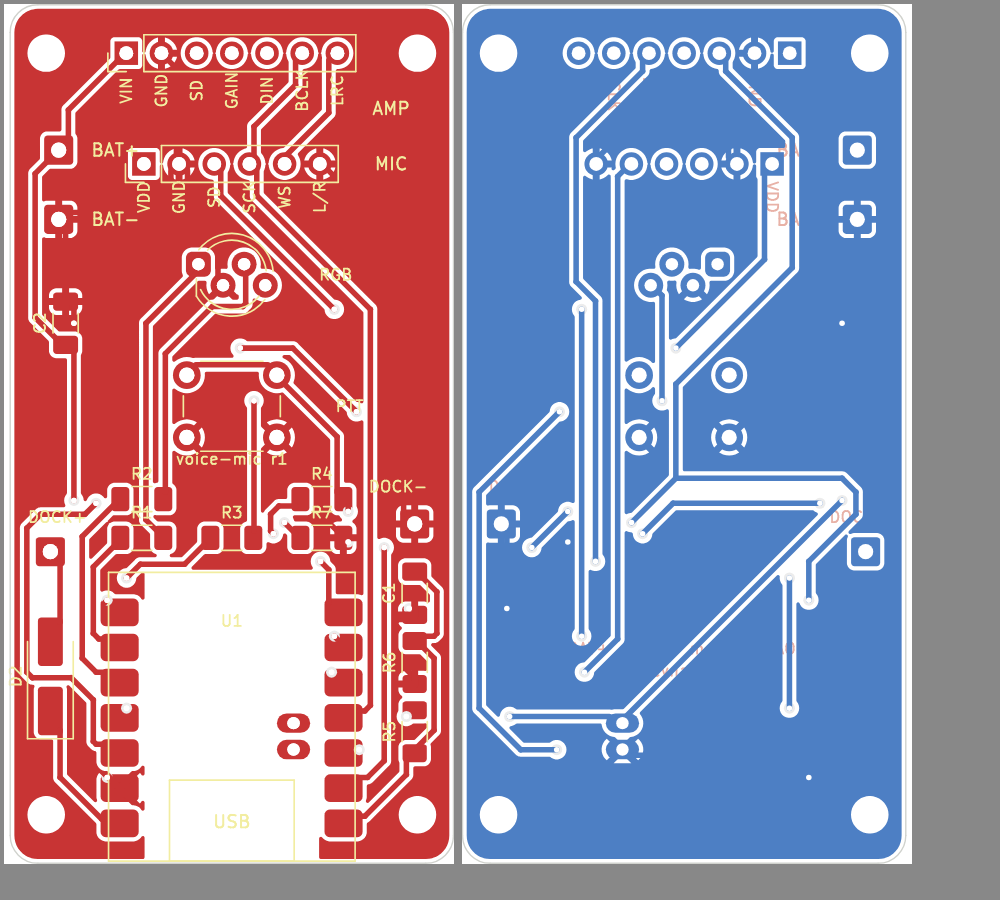
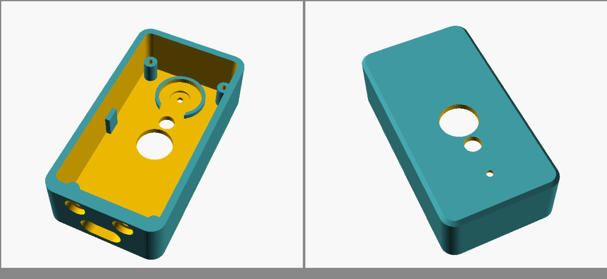

# homarMic: pilot głosowy

Mały bezprzewodowy mikrofon „naciśnij i mów" do asystenta działającego na
komputerze w sieci domowej. Przytrzymujesz przycisk, mówisz, puszczasz.
Nagranie trafia po Wi-Fi do serwera na komputerze, a dioda potwierdza odbiór.
Między poleceniami urządzenie śpi, więc bateria starcza na tygodnie.

| | Wersja bazowa | Wersja z głośnikiem |
|---|---|---|
| Wymiary | 37 × 69 × 21 mm | 37 × 103 × 21 mm |
| Potwierdzenie | dioda RGB | dioda RGB + odpowiedź głosowa |
| Koszt części (1 szt.) | ok. 60–90 zł | ok. 75–115 zł |
| Czas pracy (30 poleceń dziennie) | ok. 2 miesiące | ok. 3–4 tygodnie |

Skąd te liczby i jak wypada własne PCB na 10 sztuk:
[docs/wybor-czesci-i-koszty.md](docs/wybor-czesci-i-koszty.md).

> **Stan projektu.** Nic z tego nie zostało jeszcze fizycznie zbudowane.
> Płytki przechodzą kontrolę DRC w KiCadzie (0 błędów elektrycznych, 0
> niepołączonych padów), modele obudowy sprawdziłem na kolizje, serwer
> przetestowałem symulowanym pilotem. Firmware'u nie udało się skompilować w
> środowisku, w którym powstał (brak dostępu do narzędzi ESP32); przeszedł tylko
> kontrolę składni. Zbuduj najpierw jedną sztukę i dopiero potem zamawiaj części
> na kolejne. Lista rzeczy do sprawdzenia jest na końcu.




## Zawartość

| Katalog | Co tam jest |
|---|---|
| `pcb/` | płytki KiCad (`voice-mic`, `voice-mic-dock`), gotowe paczki Gerber w `pcb/gerber/`, skrypt generujący |
| `case/` | model OpenSCAD i gotowe pliki STL w `case/stl/` |
| `firmware/` | program dla XIAO ESP32-S3 (PlatformIO / Arduino) |
| `server/` | serwer odbiorczy w Pythonie i symulator pilota |
| `docs/` | wybór części, kosztorysy, czas pracy |

## Jak to działa

1. Naciśnięcie przycisku budzi układ. Nagrywanie rusza po ok. 0,3 s; dioda
   zapala się na **niebiesko** dopiero wtedy, gdy mikrofon naprawdę słucha.
2. Wi-Fi łączy się w tle (ok. 1–2 s), a dźwięk w tym czasie trafia do pamięci,
   więc początek polecenia nie przepada.
3. Po puszczeniu przycisku dioda świeci na **żółto**, aż serwer odpowie.
4. **Zielony** = serwer odebrał nagranie (kod HTTP 2xx). W wersji z głośnikiem
   pilot odtwarza wtedy odpowiedź, jeśli serwer ją odesłał.
5. Układ zasypia.

| Dioda | Znaczenie |
|---|---|
| niebieska | nagrywam, mów |
| żółta | wysyłam / czekam na odpowiedź |
| zielona | polecenie odebrane |
| 3 × czerwona | błąd: brak Wi-Fi, serwer nie odpowiada albo zwrócił błąd |
| 2 × długa czerwona po poleceniu | słaba bateria, odłóż do stacji |
| 2 × biała | po włączeniu zasilania: układ działa (czerwona = słaba bateria) |

Naciśnięcie krótsze niż 0,25 s jest ignorowane. Jedno polecenie może trwać do
30 s.

## Lista części

Ceny orientacyjne z listopada 2026. Niższa wartość to AliExpress, wyższa to
polskie sklepy.

### Pilot, wersja bazowa

| Oznaczenie | Część | Szt. | Cena |
|---|---|---|---|
| U1 | Seeed Studio XIAO ESP32-S3 (zwykły, nie Sense, nie Plus), z antenką | 1 | 30–45 zł |
| — | moduł mikrofonu I2S INMP441 (okrągły, 14 mm) | 1 | 7–15 zł |
| — | akumulator LiPo 3,7 V 500 mAh typu 502535 **z zabezpieczeniem** (PCM) | 1 | 12–20 zł |
| — | płytka `voice-mic` | 1 | 5–8 zł |
| SW1 | mikroprzycisk 6 × 6 mm, THT, wysokość 5 mm | 1 | 0,30 zł |
| D1 | dioda RGB 5 mm, wspólna katoda, matowa | 1 | 0,50 zł |
| D2 | dioda Schottky'ego SS14 (SMA) | 1 | 0,30 zł |
| R1 | 470 Ω, 1206 | 1 | grosze |
| R2, R3 | 220 Ω, 1206 | 2 | |
| R4 | 100 kΩ, 1206 | 1 | |
| R5, R6 | 470 kΩ, 1206 | 2 | |
| C1 | 100 nF, 1206 | 1 | |
| — | wkręty M2 × 12 (do plastiku lub zwykłe) | 4 | 1 zł |
| — | śruby M3 × 8 z łbem kulistym na imbus (ISO 7380) + nakrętki M3 | 2 + 2 | 1 zł |
| — | magnes neodymowy 8 × 3 mm | 1 | 1 zł |
| — | przewód cienki (np. kynar/silikon 28–30 AWG), ok. 40 cm | | |
| — | filament PETG lub PLA, ok. 25 g | | 2 zł |

### Dodatkowo w wersji z głośnikiem

| Oznaczenie | Część | Szt. | Cena |
|---|---|---|---|
| — | moduł wzmacniacza I2S MAX98357A (układ pinów jak Adafruit: LRC, BCLK, DIN, GAIN, SD, GND, VIN) | 1 | 8–15 zł |
| — | głośnik 28 mm, 8 Ω, 1–2 W | 1 | 5–8 zł |
| R7 | 10 kΩ, 1206 | 1 | grosze |
| C2 | 10 µF, 1206 | 1 | grosze |
| — | wkręty M2 × 12 | 2 | |

### Stacja dokująca

| Część | Szt. | Cena |
|---|---|---|
| płytka `voice-mic-dock` | 1 | 3 zł |
| pin sprężynowy (pogo) do lutowania THT, średnica korpusu 2 mm, wysokość ok. 7 mm, trzpień do 1,2 mm | 2 | 2–4 zł |
| magnes neodymowy 8 × 3 mm | 1 | 1 zł |
| przewód USB (stary kabel z wtykiem USB-A lub gniazdo USB-C „breakout" z rezystorami 5,1 kΩ) | 1 | 0–4 zł |
| wkręty M2 × 5 | 2 | |
| filament, ok. 35 g | | 3 zł |

Jedna stacja może obsługiwać kilka pilotów po kolei. Ładowanie do pełna trwa
ok. 10–11 h (XIAO ładuje prądem 50 mA), więc najwygodniej, żeby pilot po
prostu stał w stacji, gdy go nie używasz.

## Krok 1. Zamów płytki

Paczki `pcb/gerber/voice-mic-gerber.zip` i `pcb/gerber/voice-mic-dock-gerber.zip`
wgraj jako dwa osobne zamówienia (JLCPCB, PCBWay, Aisler). Parametry:
2 warstwy, FR-4, **1,6 mm**, miedź 1 oz, dowolny kolor, wykończenie HASL.
Minimalna ilość to zwykle 5 sztuk, czyli od razu masz płytki na 5 pilotów.

## Krok 2. Wydrukuj obudowę

Pliki z `case/stl/`. PETG lub PLA, warstwa 0,2 mm, 3 obrysy, wypełnienie 20%,
**bez podpór**. Części są już ułożone do druku.

| Plik | Ułożenie |
|---|---|
| `tub.stl` / `tub-speaker.stl` | przednią ścianką do stołu |
| `lid.stl` / `lid-speaker.stl` | zewnętrzną stroną do stołu |
| `button.stl` | klawiszem do stołu |
| `dock.stl` | tak jak stoi |

Wymiary zmienisz w `case/voice_mic.scad` (wszystko jest w parametrach na
górze pliku), a potem:

```bash
openscad -D 'part="tub"' -D speaker=false -o tub.stl voice_mic.scad
```

Najczęściej trzeba będzie dopasować `mic_shape` / `mic_d` (moduły INMP441
bywają okrągłe albo kwadratowe 14 × 14 mm) oraz `pogo_body` i `pogo_hole` do
kupionych pinów pogo.

## Krok 3. Zlutuj płytkę pilota

Wszystko da się zlutować zwykłą lutownicą z cienkim grotem. Kolejność ma
znaczenie.

1. **Elementy SMD** (przód płytki): R1–R6, C1, D2. Pasek na D2 (katoda) jest
   po stronie dolnej krawędzi płytki, czyli od strony USB. W wersji z
   głośnikiem także R7 i C2.
2. **Moduł XIAO.** Połóż go płasko na przedzie płytki, gniazdem USB w stronę
   dolnej krawędzi (gniazdo wystaje ok. 1,5 mm poza płytkę). Wyrównaj pady
   krawędziowe, przylutuj dwa po przekątnej, sprawdź ułożenie, potem pozostałe
   12.
3. **Pady baterii XIAO.** Odwróć płytkę. Pod modułem są dwa owalne otwory
   opisane na tylnej stronie. Przyłóż grot do otworu, podaj cynę i trzymaj
   2–3 s, aż wypełni otwór i złapie pad na spodzie modułu. Zrób to dla obu.
   Bez tego pilot działa tylko z USB.
4. **Przycisk SW1.**
5. **Mikrofon.** Przylutuj 6 przewodów długości ok. 25 mm do pól `MIC`
   (VDD, GND, SD, SCK, WS, L/R) i do tak samo opisanych pól modułu INMP441.
   Kolejność pól na module bywa różna, kieruj się opisami, nie położeniem.
6. **Dioda D1.** Włóż ją w płytkę, ale jeszcze nie lutuj. Najdłuższa nóżka
   (wspólna katoda) idzie do drugiego otworu od lewej. Włóż płytkę do
   wydrukowanej wanny, dosuń diodę tak, żeby czubek był równo z powierzchnią
   obudowy, i dopiero wtedy przylutuj nóżki od tyłu.
7. **Antena.** Wepnij dołączoną antenkę w złącze na module XIAO.
8. **Wersja z głośnikiem:** moduł MAX98357A lutujesz od **tylnej** strony
   płytki do pól `AMP`, elementami do tyłu, tak żeby wystawał ponad górną
   krawędź płytki. Opisy pól na płytce (VIN, GND, SD, GAIN, DIN, BCLK, LRC)
   muszą się pokryć z opisami na module. Głośnik przylutuj dwoma przewodami do
   wyjścia modułu.

Baterii jeszcze nie podłączaj.

## Krok 4. Wgraj program i przetestuj na kablu

```bash
cd firmware
cp include/config.example.h include/config.h
```

W `include/config.h` wpisz nazwę i hasło Wi-Fi, adres komputera z asystentem
i ewentualnie `HAS_SPEAKER 1`. Potem podłącz pilota kablem USB-C:

```bash
pio run -t upload
```

```bash
pio device monitor
```

Jeśli komputer nie widzi portu, przytrzymaj malutki przycisk `B` (BOOT) na
module XIAO i dopiero wtedy wepnij kabel. To samo zrób przy każdym kolejnym
wgrywaniu, bo śpiący układ odłącza się od USB.

W Arduino IDE: płytka „XIAO_ESP32S3", **PSRAM: OPI PSRAM**, USB CDC On Boot:
Enabled; pliki `src/main.cpp` i `include/config.h` wrzuć do jednego szkicu.

Uruchom serwer (krok 6), przytrzymaj przycisk, powiedz coś, puść. Powinieneś
zobaczyć niebieski, żółty i zielony, a w katalogu `server/recordings/` plik
WAV. Odsłuchaj go. Jeśli jest za cicho lub przesterowane, zmień
`MIC_GAIN_SHIFT` w `config.h`. Jeśli kolory diody są zamienione (diody RGB
mają różne układy nóżek), zamień numery `PIN_LED_R/G/B` w `main.cpp`.

## Krok 5. Bateria, styki i składanie

1. **Bateria.** Sprawdź miernikiem biegunowość przewodów. Czerwony do `BAT+`,
   czarny do `BAT-`. Lutuj po jednym przewodzie i nie zwieraj ich ze sobą.
   Po podłączeniu dioda mignie dwa razy na biało.
2. **Styki ładowania.** W dolną ściankę wanny wkręć od zewnątrz dwie śruby
   M3 × 8. Od środka załóż na każdą oczko z odizolowanego przewodu i dokręć
   nakrętką. Patrząc od przodu (przycisk do ciebie, USB na dole): lewa śruba
   to `DOCK+`, prawa `DOCK-`. Przylutuj przewody do tak opisanych pól płytki.
   Na stykach nie ma napięcia, gdy pilot nie stoi w stacji.
3. **Magnes.** Wklej magnes w okrągłe gniazdo w dolnej ściance (od środka,
   między śrubami). Zrób to przed włożeniem płytki.
4. Włóż klawisz w otwór wanny (kołnierzem do środka).
5. Wsuń moduł mikrofonu w okrągłe gniazdo na przedniej ściance, **stroną z
   otworkiem do ścianki**, puszką mikrofonu do środka. Przyklej kroplą kleju
   przy krawędzi, nie zalewając otworka.
6. Wersja z głośnikiem: wklej głośnik membraną do kratki.
7. Połóż płytkę na słupkach, gniazdem USB w otwór dolnej ścianki.
8. Baterię przyklej taśmą piankową do tyłu płytki, między tulejami pokrywy.
   Antenę przyklej do bocznej ścianki, z dala od baterii.
9. Załóż pokrywę i skręć czterema wkrętami M2 × 12 (sześcioma w wersji z
   głośnikiem). Wkręty przechodzą przez płytkę i trzymają wszystko razem.

## Krok 6. Stacja dokująca

1. Wklej magnes w gniazdo od spodu podłogi stacji. **Sprawdź biegun:** musi
   przyciągać magnes w pilocie, nie odpychać.
2. Przylutuj dwa piny pogo do płytki stacji, a do pól `+` i `-` przewód 5 V
   z kabla USB (czerwony = +5 V, czarny = masa).
3. Wsuń płytkę pinami do góry w komorę od spodu i przykręć dwoma wkrętami
   M2 × 5. Piny powinny wystawać ok. 1,3 mm ponad podłogę. Pin `+5V` musi
   wypaść pod lewą śrubą pilota (patrząc od strony wycięcia w stacji).
4. Przewód wyprowadź kanałem do tyłu i unieruchom kroplą kleju.
5. Zmierz miernikiem: między pinami ma być 5 V, plus po właściwej stronie.

Pilot wstawiasz przyciskiem w stronę wycięcia. Włożony odwrotnie po prostu
się nie ładuje (dioda D2 chroni przed odwrotną biegunowością). Ładowanie
sygnalizuje czerwona dioda na module XIAO, widoczna przez szczelinę przy
gnieździe USB.

## Krok 7. Serwer na komputerze

Serwer wzorcowy nie ma żadnych zależności poza Pythonem 3.8+:

```bash
python3 server/voice_server.py --port 8765
```

Zapisuje każde polecenie jako WAV (16 kHz, 16 bit, mono) w `recordings/`.
Żeby od razu przekazywać nagrania do agenta:

```bash
python3 server/voice_server.py --exec "python3 moj_agent.py"
```

Po każdym nagraniu uruchomi się `moj_agent.py <ścieżka.wav>`. Jeśli program
wypisze na standardowe wyjście ścieżkę do pliku `.wav`, a pilot ma głośnik,
ten plik wróci do pilota jako odpowiedź głosowa (WAV, PCM 16 bit, mono,
najlepiej 16–24 kHz).

Możesz też wbudować odbiór we własnego agenta:

```python
from voice_server import serve

def handle(wav_path, meta):   # meta: device, battery_mv, speaker, seconds
    tekst = transkrybuj(wav_path)      # np. faster-whisper
    odpowiedz = agent(tekst, zrodlo=meta["device"])
    return None                        # albo ścieżka / bajty WAV z odpowiedzią

serve(handle, port=8765)
```

Zielona dioda zapala się dopiero, gdy `handle` się zakończy, więc jeśli agent
myśli długo, uruchom go w tle i wróć od razu. Wyjątek w `handle` daje kod 500
i czerwoną diodę.

Bez pilota przetestujesz serwer tak:

```bash
python3 server/fake_mic.py --host 127.0.0.1
```

Zapora systemowa musi przepuszczać port 8765 z sieci lokalnej. Komputerowi
warto nadać stały adres IP w routerze.

### Protokół (gdybyś pisał własny odbiornik)

```
POST /api/voice HTTP/1.1
Transfer-Encoding: chunked
Content-Type: application/octet-stream
X-Audio-Format: pcm_s16le
X-Sample-Rate: 16000
X-Channels: 1
X-Device-Id: mic-a1b2c3        nazwa pilota (z config.h albo z adresu MAC)
X-Battery-Mv: 3912
X-Speaker: 0                   1 = pilot potrafi odtworzyć odpowiedź
X-Auth-Token: ...              tylko gdy ustawiony w config.h

<surowe próbki PCM, little-endian>
```

Odpowiedź: dowolny kod 2xx oznacza „odebrane". Jeśli `Content-Type` to
`audio/wav` i podany jest `Content-Length`, wersja z głośnikiem odtworzy
treść. Odpowiedź musi mieć `Content-Length` (bez `chunked`). Na odpowiedź
pilot czeka do 30 s.

## Wiele pilotów

Każdy pilot ma ten sam program. Rozróżnia je nagłówek `X-Device-Id`; domyślnie
to `mic-` plus końcówka adresu MAC, a w `config.h` możesz wpisać własną nazwę
(np. `kuchnia`) przed wgraniem. Serwer obsługuje wiele pilotów jednocześnie.

## Problemy

| Objaw | Co sprawdzić |
|---|---|
| Działa na USB, nie działa na baterii | otwory `BAT+`/`BAT-` pod XIAO nie złapały padów modułu; dolutuj od tyłu |
| 3 × czerwona zaraz po puszczeniu | serwer nie działa, zły adres w `config.h` albo zapora |
| 3 × czerwona po ok. 10 s | brak połączenia z Wi-Fi (hasło, zasięg, sieć tylko 5 GHz; ESP32 potrzebuje 2,4 GHz) |
| Nagranie to cisza | zamienione przewody SD/SCK/WS albo `L/R` nie jest na masie |
| Ucięty początek polecenia | zacznij mówić, gdy zapali się niebieska dioda |
| Klawisz nie klika albo jest stale wciśnięty | inna wysokość mikroprzycisku; zmień `sw_h` w pliku SCAD |
| Nie ładuje w stacji | odwrócona biegunowość pinów, za krótkie piny, magnes odpycha |
| Bateria pada po kilku dniach | zmierz prąd uśpienia (powinno być ok. 20 µA); patrz niżej |

## Do sprawdzenia przy pierwszej sztuce

- Kompilacja firmware'u prawdziwym narzędziem (PlatformIO). Program używa
  starszego sterownika I2S (`driver/i2s.h`), który działa z rdzeniem Arduino
  ESP32 2.x i 3.x.
- Prąd uśpienia. Seeed podaje 14 µA dla XIAO ESP32-S3, dzielnik baterii
  dokłada ok. 4,5 µA. Niektóre niezależne pomiary pokazują wyraźnie więcej,
  więc zmierz to miernikiem włączonym szeregowo z baterią.
- Dopasowanie modułu INMP441 do gniazda i pinów pogo do stacji (części z
  AliExpress różnią się wymiarami między sprzedawcami).
- Siła magnesu względem nacisku pinów pogo: pilot ma sam dosiadać w stacji.
  Jeśli „pływa" na pinach, weź piny o mniejszym nacisku albo mocniejszy
  magnes (parametry `magnet_d`, `magnet_h`).
- Luz klawisza i głębokość gniazda USB-C z twoim kablem.

## Zmiany w płytce

Płytki powstają ze skryptu `pcb/gen_pcb.py` (wymaga KiCada 7 lub nowszego z
modułem `pcbnew`); rozmieszczenie, sieci i opisy są w nim zapisane wprost,
a ścieżki prowadzi `pcb/router.py`. Pliki `.kicad_pcb` można też po prostu
otworzyć i poprawić ręcznie w KiCadzie. Schemat połączeń jest w
[docs/wybor-czesci-i-koszty.md](docs/wybor-czesci-i-koszty.md#schemat-połączeń).
Wymiary padów modułu XIAO pochodzą z biblioteki Seeed Studio OPL (CC BY-SA 4.0).
